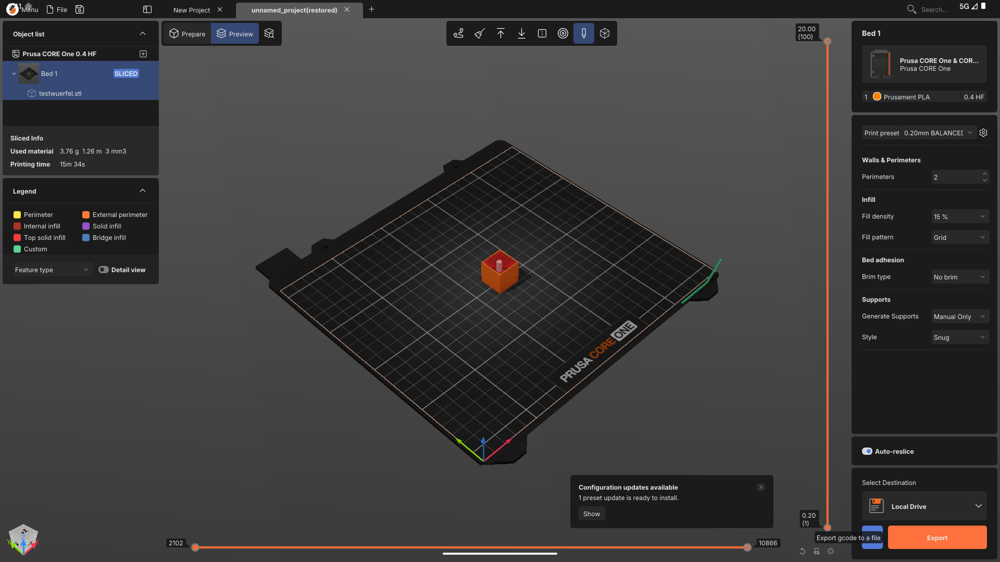

# PrusaSlicer for Android (Googlebook OS)

A native Android port of [PrusaSlicer](https://github.com/prusa3d/PrusaSlicer) 3.0.0-alpha12 for Android devices such as Googlebooks running gbOS – a real APK, no Linux container or X11.

Releases contain one APK per architecture: `x86_64` (Googlebooks, emulator) and `arm64-v8a` (phones, tablets, ARM Chromebooks; so far only tested in the emulator, not on real ARM hardware).

## What it does

- Runs PrusaSlicer's own ImGui interface on SDL2 and OpenGL ES 3 (ANGLE)
- Open models (Files app, "Open with", share, drag & drop), slice, G-code preview, export
- Side bar like the desktop: Connect, Printables, preferences and Prusa Account login
- Prusa Connect and Printables ("Open in PrusaSlicer") through PrusaSlicer's own browser logic in an Android WebView
- Touchpad gestures: pinch to zoom, two-finger swipe to pan or scroll lists

## Layout

| Path | Content |
|---|---|
| `apply-patches.sh` | All changes to the PrusaSlicer sources and its dependency recipes (idempotent) |
| `build-deps.sh`, `build-app.sh` | Builds the dependencies and `libmain.so` with the Android NDK (r27c) |
| `slic3r-app-android/` | Android app layer (app setup, dialogs, WebView host, JNI bridge) |
| `slic3r-platform-sdl/` | SDL2 render canvas and main thread dispatcher |
| `app-project/` | Gradle project: activity, side bar, WebView pages |
| `deploy.ps1` | Build, package and install the APK (`-Abi x86_64` or `-Abi arm64-v8a`) |

## License

AGPL-3.0, like PrusaSlicer.
